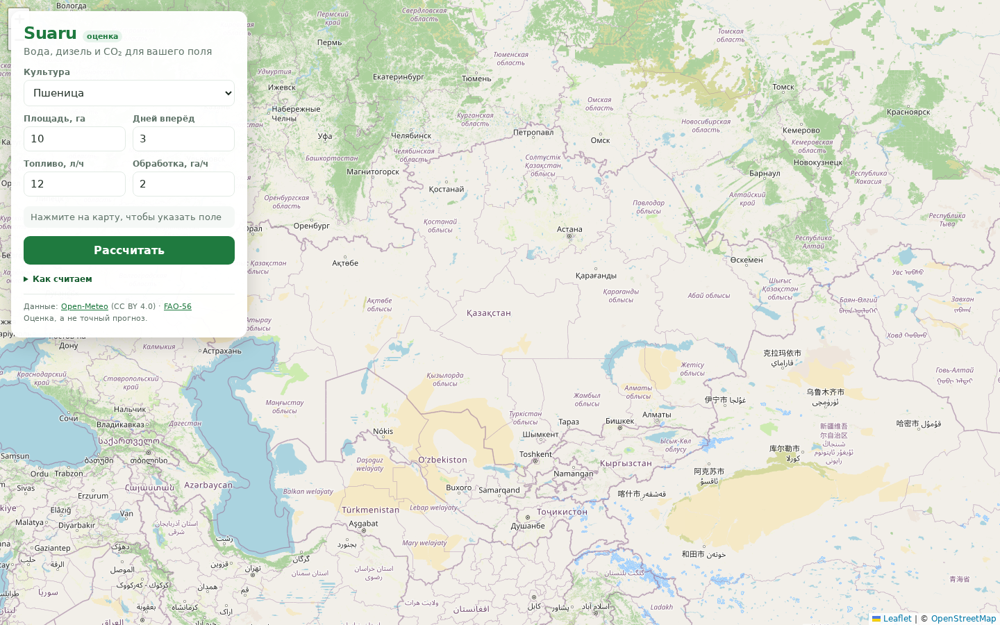

# Демо Suaru: сценарий на 3 минуты

Стартовый экран:



## Подготовка (за 10 минут до выхода)

- Открыть приложение в браузере на всю ширину, страницу увеличить
  (Cmd/Ctrl + «+» один раз — чтобы цифры читались с последнего ряда).
- Проверить, что тайлы OpenStreetMap загрузились (карта не серая).
- Второй вкладкой открыть `/docs` — на случай вопроса «а что там под капотом».
- Терминал с `curl` держать закрытым до шага 6 (запасной сценарий).

## Сценарий

1. **Карта** (10 сек): «Фермер видит своё поле. Кликает точку — дальше сервис
   считает всё сам». Показать, что карта живая: подвигать, зум.
2. **Данные поля** (20 сек): культура — пшеница, площадь — 10 га,
   топливо 12 л/ч, обработка 2 га/ч. «Это то, что фермер знает о своём поле,
   ничего больше вводить не надо».
3. **Точка на карте** (10 сек): кликнуть по карте в районе Алматы или
   Караганды. «Один клик — и у нас координаты поля».
4. **Результат** (60 сек): нажать «Рассчитать» и разобрать карточку:
   - вода: суммарно мм и м³ за три дня — «сколько воды надо привезти»;
   - по дням: дата, дождь и полив — «если завтра дождь, полив уменьшается,
     мы не поливаем под дождь»;
   - дизель: 60 л — «один проход техники по полю»;
   - CO₂: 159 кг — «след этого дизеля в атмосфере».
5. **Как считаем** (30 сек): раскрыть блок «Как считаем» под формой.
   Kc — из FAO-56, CO₂ — из IPCC, погода — Open-Meteo.
   «Формулы прозрачные и проверяемые, это не чёрный ящик».
6. **Запасной сценарий** (30 сек, если интернет/карта подвела): показать то же
   самое через API в терминале:

   ```bash
   curl -s -X POST http://127.0.0.1:8000/api/plan \
     -H "Content-Type: application/json" \
     -d '{"lat": 43.24, "lon": 76.89, "crop": "wheat", "area_ha": 10, "l_per_h": 12, "ha_per_h": 2, "days": 3}'
   ```

   Ответ содержит те же mm/m3/diesel_l/co2_kg, что и карточка на карте.
   Если и Open-Meteo недоступен — ответ 502 честно скажет «погода не отвечает»,
   показать это не страшно, это честное поведение сервиса.

## Подготовленные цифры для пересказа

Погода меняется, поэтому запоминать точные мм не нужно. Опорные числа
(пшеница, 10 га, 3 дня):

| Показатель | Значение | Что сказать |
|---|---|---|
| Вода | ~5 мм ≈ 495 м³ | «пол-литра на каждый квадратный метр — два больших бассейна на поле» |
| Дизель | 60 л | «area / скорость × расход: 10 га / 2 га/ч × 12 л/ч» |
| CO₂ | 159 кг | «60 л × 2.65 кг/л по IPCC» |
| Kc | 1.15 | «mid-season пшеницы, таблица FAO-56» |

## Если спросят про стадии роста

Сейчас Kc только mid-season — это честно указано в ограничениях модели.
Следующий шаг: начальная / середина / конец сезона (Kc ini/mid/end по FAO-56)
и переключатель стадии в форме.

## Чего не делать на сцене

- Не вводить огромные площади и «красивые» координаты в океане — модель
  посчитает, но выглядит неправдоподобно.
- Не обещать точный агрономический прогноз: это оценка для планирования.
- Не показывать `/docs` первым — сначала карта и цифры, потом детали.
